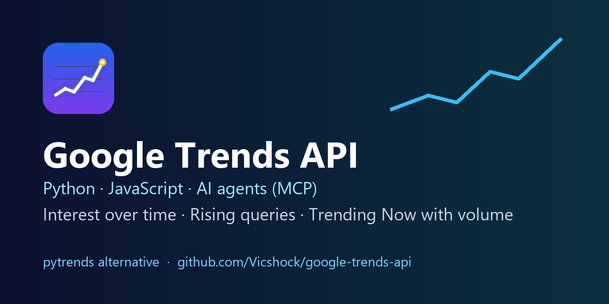

# Google Trends API for Python, JavaScript & AI agents (pytrends alternative)



**Get Google Trends data as clean JSON in one API call**: interest over time, interest by region, related and rising queries, **Trending Now with search volume**, and keyword ranking beyond 5 terms. No browser, no Google account, no quota to request.

[](https://apify.com/victorrodi/google-trends-api)
  

> `pytrends` was archived in April 2025 and now often fails with HTTP 429 errors. This repository shows how to get the same Google Trends data, reliably, through the hosted **[Google Trends Scraper API](https://apify.com/victorrodi/google-trends-api)** on Apify.

---

## Quick start (Python)

```bash
pip install "apify-client>=3"
```

```python
from apify_client import ApifyClient

client = ApifyClient("<YOUR_APIFY_TOKEN>")  # free token: https://console.apify.com/account/integrations
run = client.actor("victorrodi/google-trends-api").call(
    run_input={
        "searchTerms": ["iphone, samsung, pixel"],  # up to 5 terms per line are compared
        "geo": "US",
        "timeRange": "today 12-m",
    }
)
for item in client.dataset(run.default_dataset_id).iterate_items():
    print(item["type"], item.get("summary"))
```

Every `interestOverTime` result comes with a ready-made **summary** per term: average, peak, peak date, latest value and growth %.

More examples: [`examples/`](examples/).

---

## What data you get

| Data | Input | Output `type` |
|---|---|---|
| Interest over time (with average, peak, growth %) | `searchTerms`, `timeRange` | `interestOverTime` |
| Interest by region: countries, states, cities, US metros | `dataTypes: ["interestByRegion"]`, `regionResolution` | `interestByRegion` |
| Related queries, top and **rising** (incl. "Breakout") | `dataTypes: ["relatedQueries"]` | `relatedQueries` |
| **Trending Now**: search volume, growth %, start time, categories, related queries, news, for 4 h / 24 h / 48 h / 7 days | `trendingNowGeos: ["US"]`, `trendingNowHours` | `trendingNow` |
| Rank **unlimited** keywords on one 0-100 scale | `keywordRanking: true` | `keywordRanking` |
| YouTube, News, Shopping, Images search | `property: "youtube"`, `"news"`, `"froogle"`, `"images"` | same types |
| Several countries in one run | `geos: ["US", "GB", "DE"]` | one item per country |

Export as **JSON, CSV, Excel, XML** or read it from the API. You are never charged for empty results.

---

## Migrating from pytrends

| pytrends | Google Trends Scraper API input |
|---|---|
| `build_payload(kw_list, timeframe, geo, cat, gprop)` | `searchTerms: ["a, b, c"]`, `timeRange`, `geo`, `category`, `property` |
| `interest_over_time()` | `dataTypes: ["interestOverTime"]` |
| `interest_by_region(resolution="CITY")` | `dataTypes: ["interestByRegion"]`, `regionResolution: "CITY"` |
| `related_queries()` | `dataTypes: ["relatedQueries"]` |
| `trending_searches(pn="united_states")` / `realtime_trending_searches()` | `trendingNowGeos: ["US"]`, `trendingNowHours: "24"` |
| 5 keywords max per comparison | `keywordRanking: true` ranks any number of keywords on one scale |
| `TooManyRequestsError` (429) | handled for you: session retries, new IPs, residential fallback |

`timeRange` accepts the same strings as the pytrends `timeframe`: `now 1-H`, `now 4-H`, `now 1-d`, `now 7-d`, `today 1-m`, `today 3-m`, `today 12-m`, `today 5-y`, `all`, or a custom range in `customTimeRange` such as `2024-01-01 2024-12-31`.

---

## JavaScript / Node.js

```javascript
import { ApifyClient } from 'apify-client';

const client = new ApifyClient({ token: process.env.APIFY_TOKEN });
const run = await client.actor('victorrodi/google-trends-api').call({
  trendingNowGeos: ['US', 'GB'],
  trendingNowHours: '24',
  trendingNowMaxItems: 20,
});
const { items } = await client.dataset(run.defaultDatasetId).listItems();
for (const t of items) console.log(t.geo, t.rank, t.title, t.searchVolume, `${t.growthPct}%`);
```

## cURL (run and get the results in one request)

```bash
curl -X POST "https://api.apify.com/v2/acts/victorrodi~google-trends-api/run-sync-get-dataset-items" \
  -H "Authorization: Bearer $APIFY_TOKEN" -H "Content-Type: application/json" \
  -d '{"searchTerms": ["air fryer"], "geo": "US", "timeRange": "today 5-y"}'
```

---

## Use Google Trends from Claude, ChatGPT, Cursor (MCP)

### Option 1: `google-trends-mcp` (this repo, 4 focused tools)

| Tool | What it returns |
|---|---|
| `google_trends_interest` | Interest over time for up to 5 terms, with average, peak, latest and growth % |
| `google_trends_related_queries` | Top and rising queries for a term, incl. "Breakout" |
| `google_trends_trending_now` | What a country searches right now, with search volume and news |
| `google_trends_rank_keywords` | Any number of keywords ranked on one 0-100 scale |

Claude Desktop / Cursor config (needs [uv](https://docs.astral.sh/uv/)):

```json
{
  "mcpServers": {
    "google-trends": {
      "command": "uvx",
      "args": ["--from", "git+https://github.com/Vicshock/google-trends-api", "google-trends-mcp"],
      "env": { "APIFY_TOKEN": "<YOUR_APIFY_TOKEN>" }
    }
  }
}
```

Claude Code: `claude mcp add google-trends -e APIFY_TOKEN=<YOUR_APIFY_TOKEN> -- uvx --from git+https://github.com/Vicshock/google-trends-api google-trends-mcp`

Each tool call is capped at $0.50 (`GOOGLE_TRENDS_MAX_CHARGE_USD` to change it); a typical call costs under one cent.

### Option 2: the Apify MCP server

```json
{
  "mcpServers": {
    "apify": {
      "command": "npx",
      "args": ["-y", "@apify/actors-mcp-server", "--actors", "victorrodi/google-trends-api"],
      "env": { "APIFY_TOKEN": "<YOUR_APIFY_TOKEN>" }
    }
  }
}
```

Then ask: *"What is trending on Google in the UK right now? Use victorrodi/google-trends-api."* or *"Compare iphone, samsung and pixel in the US over 12 months and tell me which one is growing."*

---

## Pricing

Pay per result, platform and proxies included: about **$0.0025 per result** on the Apify Starter plan, less on higher plans. A 1-keyword run with all data types returns 3 results (about $0.0075). Apify gives every account monthly free credit to try it. Live prices: [apify.com/victorrodi/google-trends-api](https://apify.com/victorrodi/google-trends-api).

## FAQ

**Is there an official Google Trends API?** Google opened an alpha API to a small group of testers only. This Actor returns the same data today, with no application.

**Why do values go from 0 to 100?** Google Trends publishes a relative interest index, not absolute counts. Trending Now items do include the approximate **search volume** shown by Google.

**Can I compare more than 5 keywords?** Yes: set `keywordRanking: true`. Terms are queried in batches sharing an anchor term and rescaled onto one scale.

**Can I schedule daily Google Trends reports?** Yes: save the input as an Apify Task, add a Schedule, and send the dataset to Google Sheets, Slack, Make, Zapier or n8n.

**Is it legal?** The Actor collects public, aggregated, anonymous statistics, no personal data. Check that your use complies with the Google terms and your local laws.

## Links

- Actor page: https://apify.com/victorrodi/google-trends-api
- Docs website: https://vicshock.github.io/google-trends-api/
- Issues and feature requests: open an issue here or on the Actor page.

License: MIT (examples and docs in this repository).
